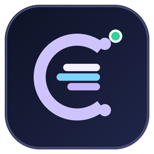

<p align="center">
  
</p>

<h1 align="center">Codex Status Bar</h1>

<p align="center">A Windows tray app and floating overlay for tracking local Codex chat usage, context, and account quotas.</p>

<p align="center">
  <a href="https://github.com/kieuhuuthanh23698/codex-status-bar/actions/workflows/windows-build.yml"></a>
  
  
</p>

Codex Status Bar keeps selected usage metrics visible while you work. It runs in the system tray, can show a compact bar on one or more monitors, and keeps its history on your PC.

> This is an independent community project, not an official OpenAI product. It uses local Codex CLI/app-server interfaces that may change over time.

## Features

- **Floating status bar and tray icon** for session tokens, context usage, and five-hour and weekly quota.
- **Chat dashboard** with local chat history, model details, pinned-chat selection, and CSV export.
- **Daily token analytics** with 7-, 30-, and 90-day ranges, model filters, and input/output breakdowns.
- **Multi-monitor controls** to choose displays, drag and lock each bar, and hide bars over full-screen apps.
- **Configurable refresh and warnings**, Windows startup, opacity, display mode, and quota display.
- **Local-first data handling** that uses your existing Codex CLI sign-in and does not ask for API keys or passwords.

## Requirements

- Windows 10 version 2004 or later, or Windows 11.
- Codex CLI installed and signed in. The app checks the `PATH` and the Codex app's bundled CLI location.

The app-server usage interface is experimental. Codex CLI updates may change the available data or behavior; the app reports unavailable data and may show cached measurements as stale.

## Install or build

Use the packaged Windows executable from [GitHub Releases](https://github.com/kieuhuuthanh23698/codex-status-bar/releases) when a release is available, or build from source.

```powershell
git clone https://github.com/kieuhuuthanh23698/codex-status-bar.git
cd codex-status-bar
dotnet restore .\CodexStatusBar.csproj
dotnet build .\CodexStatusBar.csproj --configuration Release
```

To publish a self-contained Windows x64 executable:

```powershell
dotnet publish .\CodexStatusBar.csproj --configuration Release --runtime win-x64 --self-contained true
```

The publish output is written to `bin\Release\net8.0-windows10.0.19041.0\win-x64\publish\CodexStatusBar.exe` and copied to `release\CodexStatusBar.exe`. The self-contained executable includes the .NET and Windows App SDK runtimes, so it is large. It may unpack runtime components into a temporary directory on first launch. Close the running app before publishing so Windows can replace the release copy.

## How it works

The app starts in the system tray with the floating bar enabled. Click the tray icon or bar to open the dashboard; right-click for commands. The selected chat is resumed through the local Codex app-server to receive current token usage. Other chats remain available with cached measurements until selected.

Context usage is estimated from the latest input token count divided by the context window reported for the selected model. Daily token totals and model attribution come from local Codex rollout metadata. The app imports token-count records only; records without model metadata are grouped as **Unknown model**.

## Privacy and local data

Application settings, chat metadata, usage measurements, and logs are stored under `%LocalAppData%\CodexStatusBar`. The local database includes chat IDs, labels, workspace metadata, timestamps, model names, token/context measurements, and quota measurements. Usage history is retained for up to 90 days.

For daily analytics, the app reads local Codex rollout JSONL files and imports token-count records. It does not retain prompts or conversation transcripts. The app uses the Codex CLI's existing sign-in rather than collecting credentials. Error logs contain technical exception details and paths, but omit prompts, transcripts, token values, and RPC payloads.

## License

This project is licensed under the [MIT License](LICENSE). You may use, modify, and distribute it, including commercially, as long as the copyright and license notices are preserved. The license disclaims warranties and liability. Third-party dependencies remain under their respective licenses.

## Project notes

The original product concept is preserved in [`docs/initial-product-brief.md`](docs/initial-product-brief.md). It is a historical planning document; the feature list above describes the current app.
